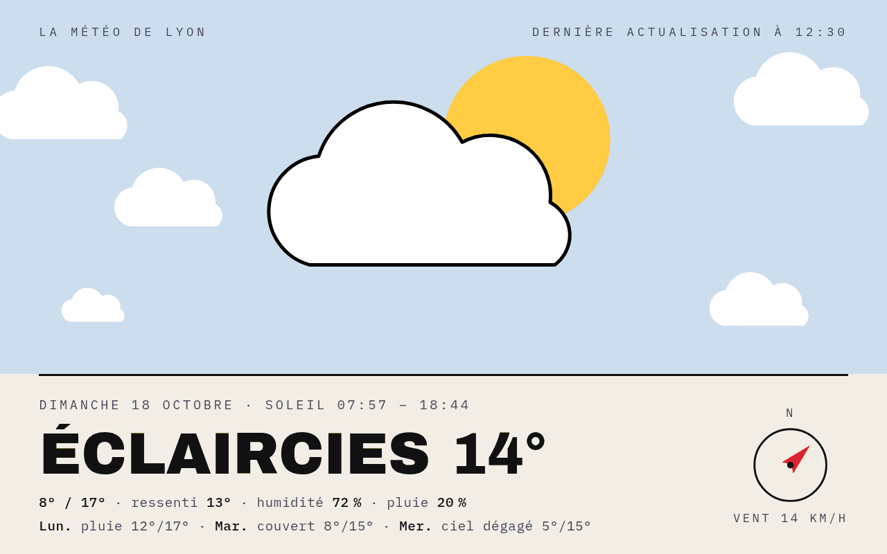
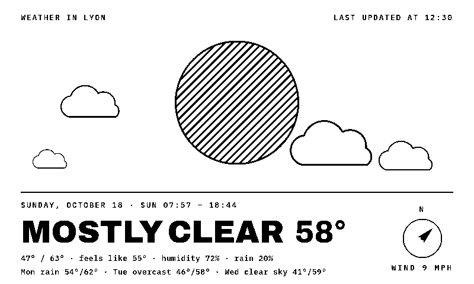
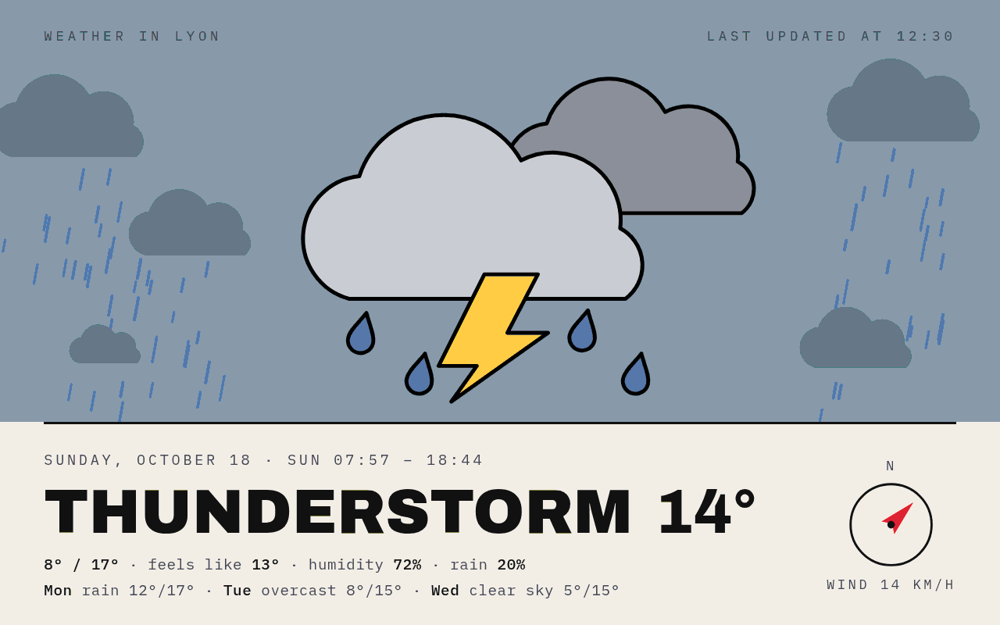
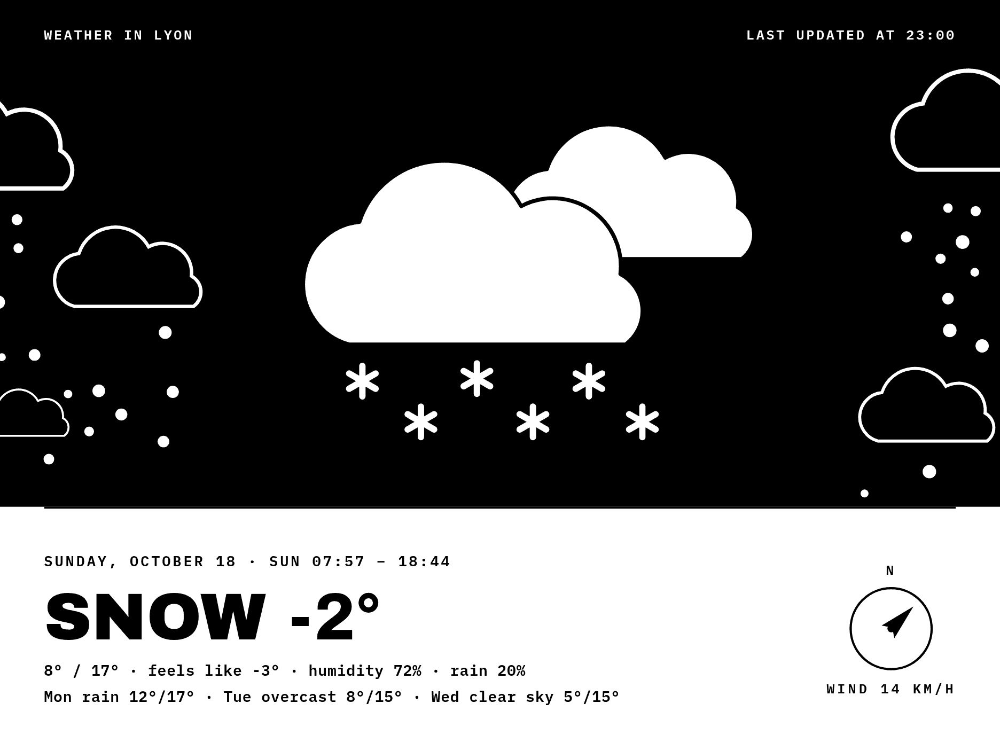
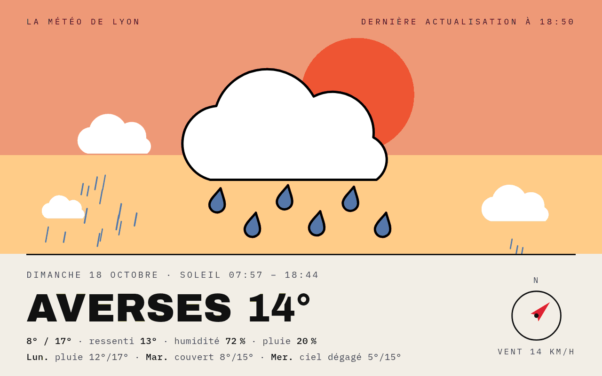
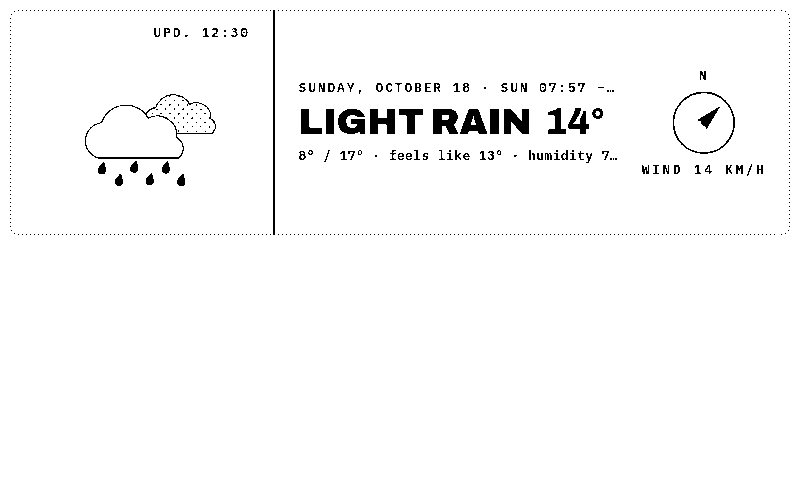
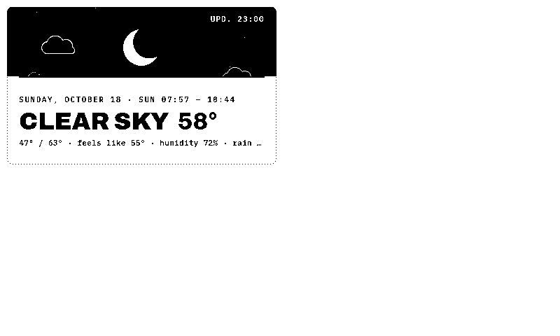
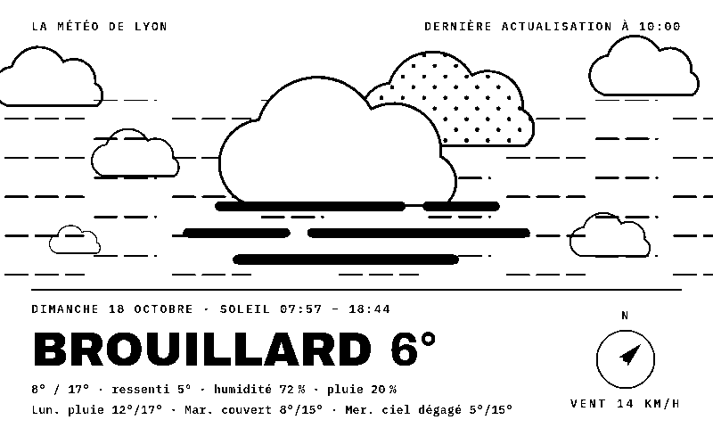

# WeatherPoster

**[English](#english) · [Français](#français)**

---

## English

*The weather at home, drawn as a poster.*

A TRMNL plugin that shows today's weather as a poster: a big illustration of the real sky (sun, dusk or night, clouds, rain, snow, fog, thunderstorms), the temperature in large type, today's numbers, the next three days and a wind compass. It is part of the Poster suite with [FlightPoster](https://github.com/BartoX360/FlightPoster), [GamePoster](https://github.com/BartoX360/GamePoster), [MoviePoster](https://github.com/BartoX360/MoviePoster), [ShowPoster](https://github.com/BartoX360/ShowPoster) and [BookPoster](https://github.com/BartoX360/BookPoster), and shares their look.

No server to install: the data comes from [Open-Meteo](https://open-meteo.com) (free, no API key, CC BY 4.0).

### Features

- **E-ink and color**: a pure black & white style built for 1-bit screens (TRMNL OG, TRMNL X), and a color style for LCD screens
- **Every layout**: full screen, half horizontal, half vertical and quadrant (mashups)
- **Real sky**: day, dusk or night from the sun's position, plus the current weather
- **Today**: current conditions and temperature, min / max, feels like, humidity, chance of rain, sunrise and sunset
- **Next three days**: conditions and min / max temperatures (full screen layout)
- **Wind compass**: the needle points where the wind blows, with its speed
- **English or French**, **metric or imperial** units

### Screenshots

| | |
|---|---|
|  |  |
| E-ink · mostly clear · imperial units | Color · thunderstorm |
|  |  |
| TRMNL X · snowy night | Color · showers at dusk |
|  |  |
| Half horizontal · light rain | Quadrant · clear night |

### Installation

**TRMNL (usetrmnl.com)**: create a *Private Plugin* with the *Polling* strategy, then copy:
- `polling_url` from `recipe/src/settings.yml` into *Polling URL*;
- the `custom_fields` from `recipe/src/settings.yml` into *Custom fields* (YAML);
- `recipe/src/shared.liquid` into *Shared markup*, and each `recipe/src/<layout>.liquid` into the matching layout tab.

The `recipe/src/` folder follows the [trmnlp](https://github.com/usetrmnl/trmnlp) layout.

**LaraPaper / BYOS**: *Plugins → Import recipe*, pick `weatherposter-x.y.z.zip` from the [latest release](https://github.com/BartoX360/WeatherPoster/releases/latest) (or zip the contents of `recipe/src/`), then fill in your settings.

### Settings

| Field | Purpose |
|---|---|
| Latitude / Longitude | Your home's position |
| Display name | Shown in "Weather in …" (defaults to "Weather at home") |
| Language | English or French |
| Units | Metric (°C, km/h) or imperial (°F, mph) |
| Style | E-ink (black & white) or Color |

### Development

| File | Purpose |
|---|---|
| `dev/recipe_render.sh <folder>` | Zips the recipe, imports it into LaraPaper as "WeatherPoster (test)", renders every test case and copies the PNGs into `<folder>` |
| `dev/recipe_test.php` | The test cases (weather, light, layout, device, language, units) run inside LaraPaper |
| `dev/update.php` | Copies the code of "WeatherPoster (test)" into the installed plugin, keeping its settings |
| `dev/install.php` | First install: imports the recipe as "WeatherPoster" with FlightPoster's position |

The scripts target a LaraPaper server running in Docker (container `larapaper-app-1`) over SSH, set with `LARAPAPER_SSH` (e.g. `root@my-server`) in the environment or in `dev/.env` (ignored by git).

### Notes

- The screen is built with JavaScript at render time, so the renderer must run JavaScript.
- Open-Meteo updates every 15 minutes: a refresh interval of 15 minutes or more is enough.

---

## Français

*La météo chez vous, façon affiche.*

Un plugin TRMNL qui affiche la météo du jour comme une affiche : une grande illustration du vrai ciel (soleil, crépuscule ou nuit, nuages, pluie, neige, brouillard, orage), la température en gros, les chiffres du jour, les trois jours suivants et une boussole pour le vent. Il fait partie de la suite Poster avec [FlightPoster](https://github.com/BartoX360/FlightPoster), [GamePoster](https://github.com/BartoX360/GamePoster), [MoviePoster](https://github.com/BartoX360/MoviePoster), [ShowPoster](https://github.com/BartoX360/ShowPoster) et [BookPoster](https://github.com/BartoX360/BookPoster), dont il reprend le style.

Aucun serveur à installer : les données viennent d'[Open-Meteo](https://open-meteo.com) (gratuit, sans clé d'API, CC BY 4.0).

### Fonctionnalités

- **E-ink et couleur** : un style noir et blanc pur pensé pour les écrans 1 bit (TRMNL OG, TRMNL X), et un style couleur pour les écrans LCD
- **Tous les formats** : plein écran, demi horizontal, demi vertical et quart (mashups)
- **Vrai ciel** : jour, crépuscule ou nuit selon la position du soleil, avec la météo du moment
- **Aujourd'hui** : conditions et température actuelles, min / max, ressenti, humidité, probabilité de pluie, lever et coucher du soleil
- **Les trois jours suivants** : conditions et températures min / max (format plein écran)
- **Boussole du vent** : l'aiguille indique où souffle le vent, avec sa vitesse
- **Français ou anglais**, unités **métriques ou impériales**

### Captures

| | |
|---|---|
|  |  |
| Couleur · éclaircies | E-ink · brouillard |
|  |  |
| Couleur · averses au crépuscule | TRMNL X · nuit de neige |

### Installation

**TRMNL (usetrmnl.com)** : créez un *Private Plugin* avec la stratégie *Polling*, puis copiez :
- `polling_url` de `recipe/src/settings.yml` dans *Polling URL* ;
- les `custom_fields` de `recipe/src/settings.yml` dans *Custom fields* (YAML) ;
- `recipe/src/shared.liquid` dans *Shared markup*, et chaque `recipe/src/<format>.liquid` dans l'onglet du format correspondant.

Le dossier `recipe/src/` suit la structure de [trmnlp](https://github.com/usetrmnl/trmnlp).

**LaraPaper / BYOS** : *Plugins → Import recipe*, choisissez `weatherposter-x.y.z.zip` dans la [dernière release](https://github.com/BartoX360/WeatherPoster/releases/latest) (ou zippez le contenu de `recipe/src/`), puis remplissez vos réglages.

### Réglages

| Champ | Rôle |
|---|---|
| Latitude / Longitude | La position de votre domicile |
| Nom affiché | Affiché dans « La météo de … » (« La météo chez moi » par défaut) |
| Langue | Français ou anglais |
| Unités | Métriques (°C, km/h) ou impériales (°F, mph) |
| Style | E-ink (noir et blanc) ou Couleur |

### Développement

| Fichier | Rôle |
|---|---|
| `dev/recipe_render.sh <dossier>` | Zippe la recette, l'importe dans LaraPaper comme « WeatherPoster (test) », rend tous les cas de test et copie les PNG dans `<dossier>` |
| `dev/recipe_test.php` | Les cas de test (météo, lumière, format, appareil, langue, unités) exécutés dans LaraPaper |
| `dev/update.php` | Copie le code de « WeatherPoster (test) » dans le plugin installé, sans toucher à ses réglages |
| `dev/install.php` | Première installation : importe la recette comme « WeatherPoster » avec la position de FlightPoster |

Les scripts visent un serveur LaraPaper en Docker (conteneur `larapaper-app-1`) joignable en SSH, désigné par `LARAPAPER_SSH` (ex. `root@mon-serveur`), dans l'environnement ou dans `dev/.env` (ignoré par git).

### Remarques

- L'écran est construit en JavaScript au moment du rendu : le moteur de rendu doit exécuter JavaScript.
- Open-Meteo se met à jour toutes les 15 minutes : un intervalle de rafraîchissement de 15 minutes ou plus suffit.

---

## Licence / License

Code sous licence [MIT](LICENSE). Les données affichées appartiennent à leurs sources respectives. / Code released under the [MIT](LICENSE) license. The data shown belongs to its respective sources.
